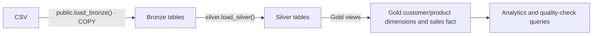

# SQL Data Warehouse

A PostgreSQL data-warehouse project adapted from [Data With Baraa’s SQL Data Warehouse project](https://github.com/DataWithBaraa/sql-data-warehouse-project). It demonstrates a medallion pipeline: six example CSV files load into Bronze, are transformed in Silver, and feed Gold star-schema views for analytics. The CSVs are examples, not independent source systems.

---

## Architecture



`scripts/bronze/ddl_bronze.sql` creates Bronze tables; `scripts/bronze/proc_load_bronze.sql` defines `load_bronze()` in `public`. The procedure uses PostgreSQL server-side `COPY` from `/home/dwh_project/datasets/`. Silver DDL and `silver.load_silver()` are in the Silver scripts. `scripts/gold/ddl_gold.sql` creates views over Silver. All six source files are sample CSVs, not independent source systems.

---

## Core Technical Stack

PostgreSQL, Docker, SQL (DDL + stored procedures), Medallion Architecture, Star Schema

---

## Local Reproduction

Requires Docker only; the following runs `psql` inside a disposable PostgreSQL 15 container, with the repository mounted read-only. It publishes no host port and uses only the committed example CSVs. **The container and its database are disposable; do not run this against a database or container with data you need.** It does not remove or modify any pre-existing container.

From the repository root:

```bash
set -eu
container="sql-warehouse-demo-$$"
docker run --rm -d --name "$container" \
  -v "$PWD:/workspace:ro" \
  -v "$PWD/datasets:/home/dwh_project/datasets:ro" \
  -e POSTGRES_PASSWORD=postgres postgres:15
trap 'docker stop "$container" >/dev/null' EXIT

until docker exec "$container" pg_isready -h 127.0.0.1 -U postgres >/dev/null 2>&1; do sleep 1; done
docker exec "$container" psql -X -v ON_ERROR_STOP=1 -U postgres -d postgres \
  -c 'CREATE DATABASE datawarehouse;'
docker exec "$container" psql -X -v ON_ERROR_STOP=1 -U postgres -d datawarehouse \
  -c 'CREATE SCHEMA bronze; CREATE SCHEMA silver; CREATE SCHEMA gold;'
for script in \
  scripts/bronze/ddl_bronze.sql \
  scripts/bronze/proc_load_bronze.sql \
  scripts/silver/ddl_silver.sql \
  scripts/silver/proc_load_silver.sql; do
  docker exec "$container" psql -X -v ON_ERROR_STOP=1 -U postgres -d datawarehouse \
    -f "/workspace/$script"
done
docker exec "$container" psql -X -v ON_ERROR_STOP=1 -U postgres -d datawarehouse \
  -c 'SET search_path TO bronze, public; CALL public.load_bronze();'
docker exec "$container" psql -X -v ON_ERROR_STOP=1 -U postgres -d datawarehouse \
  -c 'CALL silver.load_silver();'
docker exec "$container" psql -X -v ON_ERROR_STOP=1 -U postgres -d datawarehouse \
  -f /workspace/scripts/gold/ddl_gold.sql

docker exec "$container" psql -X -v ON_ERROR_STOP=1 -U postgres -d datawarehouse \
  -c 'SELECT (SELECT count(*) FROM gold.dim_customers) AS customers, (SELECT count(*) FROM gold.dim_products) AS products, (SELECT count(*) FROM gold.fact_sales) AS sales;'

# Optional diagnostics; exploratory Silver queries may return rows.
docker exec "$container" psql -X -v ON_ERROR_STOP=1 -U postgres -d datawarehouse \
  -f /workspace/tests/quality_checks_silver.sql
docker exec "$container" psql -X -v ON_ERROR_STOP=1 -U postgres -d datawarehouse \
  -f /workspace/tests/quality_checks_gold.sql

```

---

## Project Structure

```
├── scripts/
│   ├── init_database.sql
│   ├── bronze/
│   │   ├── ddl_bronze.sql
│   │   └── proc_load_bronze.sql
│   ├── silver/
│   │   ├── ddl_silver.sql
│   │   └── proc_load_silver.sql
│   └── gold/
│       └── ddl_gold.sql
├── datasets/              # Example source CSV files
├── docs/
│   ├── data_catalog.md
│   ├── data_architecture.png
│   ├── data_flow_diagram.drawio
│   ├── data_model.drawio
│   └── integration_model.drawio
└── tests/
```
